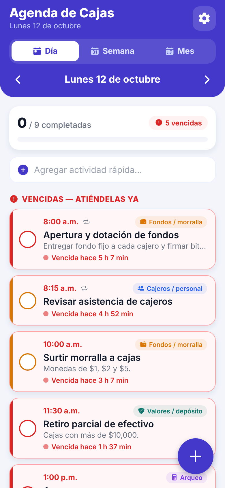
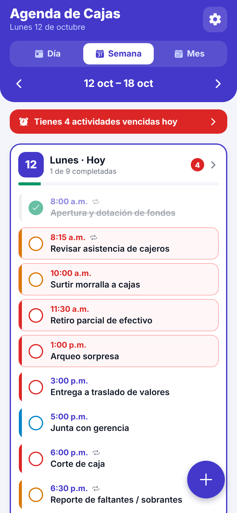
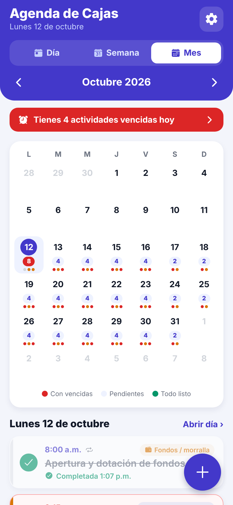
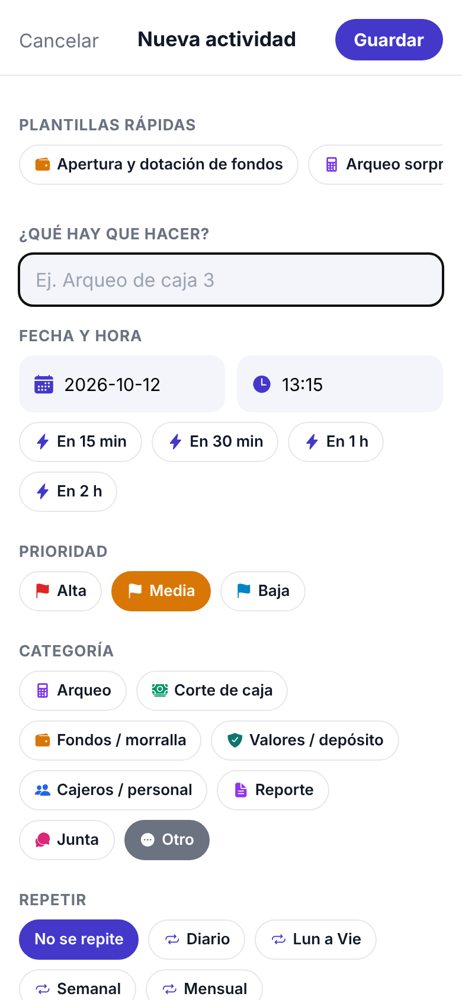
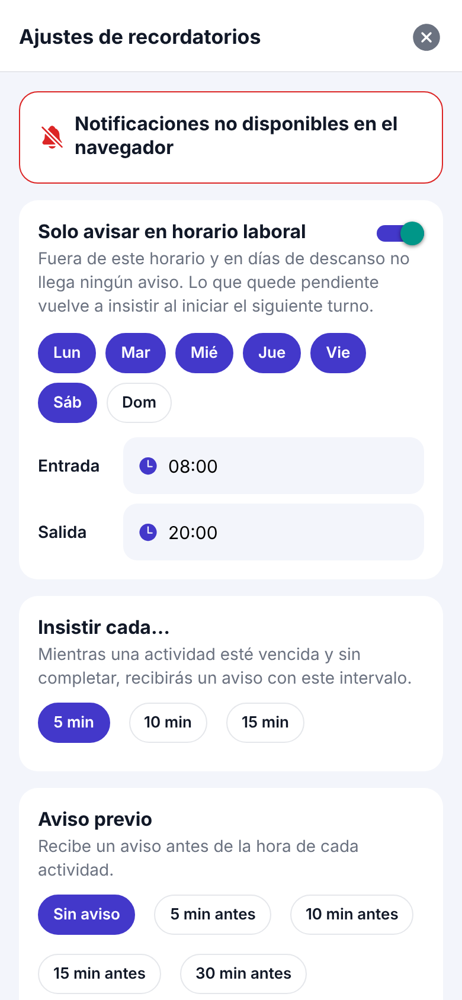

# Agenda de Cajas

App móvil (Expo / React Native) de agenda para una **jefatura de cajas**: cada
actividad tiene hora, prioridad y categoría, y cuando se vence la app
**insiste con una notificación cada 5 minutos hasta que se marque como
completada**.

| Día | Semana | Mes | Nueva actividad | Ajustes |
| --- | --- | --- | --- | --- |
|  |  |  |  |  |

## Funciones

- **Vista por día, semana y mes**, con flechas para moverse y botón *Hoy*.
  - **Día:** barra de avance (x de y completadas), secciones *Vencidas*,
    *Por hacer* y *Completadas*, y barra de **alta rápida** (escribe y Enter).
  - **Semana:** los 7 días con su avance, número de vencidas y la lista
    compacta de actividades (se pueden completar desde ahí).
  - **Mes:** calendario con contador de pendientes por día (rojo = con
    vencidas, verde = todo listo) y puntos de color por prioridad.
- **Recordatorios insistentes:** a la hora de la actividad llega "⏰ Es hora";
  si no se completa, cada 5 min llega "🔴 Pendiente…". Si hay varias vencidas
  se agrupan en un solo aviso para no saturar.
  - Botones en la notificación: **✅ Completada** y **⏸ Posponer 15 min**.
  - Intervalo configurable (5, 10 o 15 min) y aviso previo opcional.
  - **Horario laboral:** fuera del horario y en días de descanso no llega
    ningún aviso (por defecto lunes a sábado de 8:00 a 20:00, se cambia en
    ⚙️). Lo que siga pendiente vuelve a insistir al iniciar el siguiente turno.
- **Prioridad** (alta/media/baja), **categorías** propias del puesto (arqueo,
  corte, fondos/morralla, valores, cajeros, reporte, junta) y **plantillas**
  de actividades comunes.
- **Repetición:** diario, lunes a viernes, semanal o mensual. Al eliminar una
  actividad que se repite se puede borrar solo ese día o toda la serie.
- Mantener presionada una actividad la **pospone 15 min**.
- Todo se guarda en el teléfono (no requiere internet ni servidor).

## Cómo probarla

```bash
cd agenda
npm install
npx expo start
```

Escanea el QR con **Expo Go** (Android/iOS) y acepta el permiso de
notificaciones. En la pantalla vacía puedes tocar **"Cargar un día de
ejemplo"** para ver la app con actividades típicas. En ⚙️ hay un botón para
enviar una notificación de prueba.

### Instalarla en Android como app propia (APK)

Expo Go sirve para probar; para el uso diario conviene instalar la app:

```bash
cd agenda
npx eas-cli@latest login                     # cuenta gratuita de expo.dev
npx eas-cli@latest build -p android --profile apk
```

Al terminar, EAS da un enlace/QR para descargar el `.apk` en el teléfono.

Después de instalarla, en Android:
1. Acepta el permiso de notificaciones.
2. *Ajustes → Apps → Agenda de Cajas → Batería*: **Sin restricciones**.
3. *Ajustes → Apps → Acceso especial → Alarmas y recordatorios*: **Permitir**.

## Limitaciones a tener en cuenta

- Los avisos se dejan programados en el teléfono por adelantado: unas 12 h de
  avisos continuos cada 5 min (en iPhone, ~5 h por un límite del sistema). La
  app **renueva esa ventana cada vez que se abre**; abrirla una vez por turno
  basta.
- Las actividades que se repiten dejan de insistir al terminar su día (quedan
  como "No completadas"); las actividades únicas insisten hasta completarse.
- En el navegador (`expo start --web`) la app funciona, pero sin
  notificaciones.

## Estructura

```
App.js                       Encabezado, selector Día/Semana/Mes, navegación
src/store/TasksContext.js    Estado, guardado local y acciones desde notificaciones
src/logic/occurrences.js     Repeticiones y estado por día
src/logic/reminderPlan.js    Cálculo de qué avisos programar (función pura)
src/logic/notifications.js   Permisos, canal Android, botones y programación
src/views/                   DayView, WeekView, MonthView
src/components/              Tarjeta de actividad, formulario, ajustes…
```
