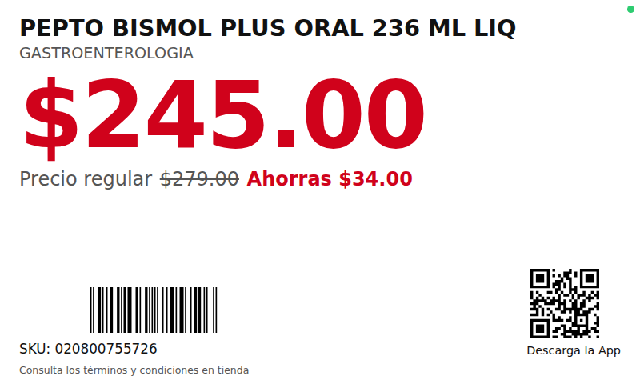

# Etiquetas digitales de precio

Sustituye las etiquetas de papel de los anaqueles por **mini pantallas** que
muestran nombre, precio, precio tachado, código de barras, SKU y QR de la app.
Cuando cambias un precio en el panel (o importas un CSV), **todas las pantallas
se actualizan al instante**, sin imprimir ni recortar nada.



## Cómo funciona

```
[Panel /admin]  --guardar precio-->  [Servidor Node.js]  --tiempo real (SSE)-->  [Pantallas /display/<id>]
  PC o celular                        una PC/mini PC o nube                       tablet, Raspberry Pi, TV...
```

- **Servidor**: Node.js + Express. Guarda productos y pantallas en `data/db.json`.
  Genera los códigos de barras (EAN‑13/UPC‑A/Code128) y el QR sin depender de internet.
- **Panel `/admin`**: alta/edición de productos y precios, asignación de
  productos a cada pantalla, importación masiva por CSV/Excel, y ve qué pantallas
  están en línea.
- **Pantalla `/display/<id>`**: una página web a pantalla completa. Si una pantalla
  tiene varios productos, los rota. Si se cae la red sigue mostrando la última
  etiqueta (guardada en el dispositivo) y se reconecta sola; un punto verde/rojo
  en la esquina indica el estado.

## Puesta en marcha

```bash
cd etiquetas-digitales
npm install
ADMIN_KEY=mi-clave-segura npm start      # http://localhost:8080
```

1. Abre `http://<ip-del-servidor>:8080/admin` y entra con la `ADMIN_KEY`.
2. En **Pantallas**, da de alta cada pantalla (ej. `pasillo-2`) y escribe los SKUs que mostrará.
3. En cada mini pantalla abre `http://<ip-del-servidor>:8080/display/pasillo-2`
   y tócala una vez para ponerla a pantalla completa.
4. Para actualizar precios: edita en **Productos**, o en **Importar CSV** sube
   el archivo exportado de tu punto de venta/Excel:

```csv
sku,nombre,departamento,precio,precio_regular,codigo_barras
020800755726,PEPTO BISMOL PLUS ORAL 236 ML LIQ,GASTROENTEROLOGIA,245.00,279.00,
```

Acepta coma o punto y coma como separador y precios tipo `$1,245.50`.

Variables de entorno: `PORT` (8080), `ADMIN_KEY` (si no se define se imprime una
temporal en consola), `DATA_DIR` (carpeta de la base de datos).

## ¿Qué pantalla usar?

| Opción | Costo aprox. | Notas |
|---|---|---|
| Tablet Android económica (7"–8") | bajo | Lo más sencillo. Usa una app de *kiosco* (p. ej. Fully Kiosk Browser) para abrir la URL al encender y evitar que se apague. |
| Raspberry Pi Zero 2 W / Pi 4 + pantalla 3.5"–7" | bajo–medio | Chromium en modo kiosco: `chromium-browser --kiosk --noerrdialogs http://servidor:8080/display/pasillo-1` |
| Mini PC o TV con navegador | medio | Para cabeceras de pasillo o pantallas grandes. |
| Etiquetas e‑ink (ESL) | medio–alto | Batería de años; requieren integración con la API del fabricante. Esta API REST (`GET /api/display/<id>`) puede alimentarlas. |

Las pantallas solo necesitan un navegador y estar en la misma red Wi‑Fi que el
servidor (o el servidor puede estar en la nube con HTTPS).

## API (resumen)

Las rutas de administración requieren el encabezado `x-admin-key`.

| Método | Ruta | Descripción |
|---|---|---|
| GET | `/api/display/:id` | Datos de una pantalla (público) |
| GET | `/api/display/:id/events` | Flujo SSE con actualizaciones en tiempo real (público) |
| GET | `/api/state` | Productos, pantallas y estado en línea |
| PUT/DELETE | `/api/products/:sku` | Crear/actualizar o borrar producto |
| POST | `/api/products/import` | Importar CSV (`Content-Type: text/csv`) |
| PUT/DELETE | `/api/screens/:id` | Crear/actualizar o borrar pantalla |
| PUT | `/api/settings` | Nombre de tienda, URL del QR, textos |
| GET | `/barcode/:codigo.svg`, `/qr.svg?text=` | Imágenes de código de barras y QR |

Con esta API se puede conectar directamente el sistema de punto de venta para
que los precios se actualicen solos, sin pasar por el panel.
